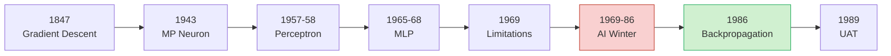

*One motif runs through this entire history: discrete processing units, wired together, computing collectively.*

## Table of Contents

1. [Chapter 1: Biological Neurons – The Origin Story](#chapter-1-biological-neurons--the-origin-story)
2. [Chapter 2: From Spring to Winter of AI](#chapter-2-from-spring-to-winter-of-ai)
3. [Chapter 3: The Deep Revival](#chapter-3-the-deep-revival)
4. [Chapter 4: From Cats to Convolutional Neural Networks](#chapter-4-from-cats-to-convolutional-neural-networks)
5. [Chapter 5: Faster, Higher, Stronger – Optimisation and Activations](#chapter-5-faster-higher-stronger--optimisation-and-activations)
6. [Chapter 6: The Curious Case of Sequences](#chapter-6-the-curious-case-of-sequences)
7. [Chapter 7: Beating Humans at Their Own Game](#chapter-7-beating-humans-at-their-own-game)
8. [Chapter 8: The Madness (2013–)](#chapter-8-the-madness-2013-)
9. [Chapter 9: The Rise of the Transformers](#chapter-9-the-rise-of-the-transformers)
10. [Chapter 10: Calls for Sanity – Interpretable, Fair, Responsible, Green AI](#chapter-10-calls-for-sanity)
11. [Chapter 11: The AI Revolution in Scientific Research](#chapter-11-the-ai-revolution-in-scientific-research)

---

## Chapter 1: Biological Neurons – The Origin Story

### 1.1 The Debate That Started It All

Even Before neural networks existed in silicon, the fundamental question was: what does the nervous system actually look like? Two competing views emerged in the 1870s and the resulting debate lasted decades.

**Reticular Theory (1871–1873)**
Joseph von Gerlach proposed that the nervous system was a single, continuous network — one giant interconnected web with no separable cells. This was an intuitive guess at the time: the brain's wiring looked impossibly dense under the microscopes available then. If you squinted at stained tissue, it did look like one unbroken mesh.

**The Neuron Doctrine (1888–1891)**
Santiago Ramón y Cajal, working with the staining technique that Camillo Golgi had discovered, saw something different. He argued that the nervous system was composed of discrete, individual cells — neurons — connected to each other through specific junctions. This was a radical reinterpretation. Cajal's meticulous drawings of neurons, which you can still find in histology textbooks today, remain some of the most beautiful scientific illustrations ever produced.

The naming credit goes to Heinrich Wilhelm Gottfried von Waldeyer-Hartz, who coined the term "neuron" around 1891 and consolidated the neuron doctrine as the dominant view.

### 1.2 Nobel Prize and the Unresolved Rivalry

In one of science's more awkward moments, both Golgi (a reticular theory proponent) and Cajal (the neuron doctrine champion) were jointly awarded the 1906 Nobel Prize in Physiology or Medicine. The ceremony did not resolve their disagreement. Golgi used his acceptance speech to attack the neuron doctrine. Cajal, in turn, used his to defend it. The controversy lingered for nearly half a century.

### 1.3 The Final Word

It was not until the 1950s that electron microscopy definitively confirmed what Cajal had argued: nerve cells are individual units, interconnected through specialised junctions called synapses. The neuron doctrine won, but it took 60 years of technological progress to settle the matter beyond doubt.

**Why this matters for deep learning:** The entire foundation of artificial neural networks rests on this understanding — that biological computation happens through networks of discrete processing units communicating via weighted connections. When McCulloch and Pitts later built their artificial neuron in 1943, they were building on Cajal's insight.

---

## Chapter 2: From Spring to Winter of AI

### 2.1 The McCulloch-Pitts Neuron (1943)

Warren McCulloch, a neuroscientist with interests bordering on philosophy, and Walter Pitts, a self-taught mathematical prodigy who had arrived at the University of Chicago at age 15 and mastered Whitehead and Russell's *Principia Mathematica* by age 12, published a paper that changed the trajectory of computing.

Their 1943 paper, "A Logical Calculus of the Ideas Immanent in Nervous Activity," proposed that the behaviour of a neuron could be modelled as a simple logical operation. A neuron fires if its inputs exceed a threshold — that is the "all-or-none" character of nervous activity. By connecting these logical units in different configurations, McCulloch and Pitts showed they could implement any Boolean function.

The implications were staggering. John von Neumann cited this paper as a key influence when he designed the EDVAC computer architecture. The diagrams McCulloch and Pitts drew of neural circuits — effectively AND, OR, and NOT gates — lie at the core of every digital computer built since.

**The human angle:** Walter Pitts, despite his brilliance, had a tragic ending. After a falling out between McCulloch and Norbert Wiener, Pitts fell into depression, burned his doctoral thesis, and died from alcoholism. His early death at 46 cut short one of the most promising careers in computational neuroscience.

### 2.2 The Perceptron (1957–1958)

Frank Rosenblatt, working at the Cornell Aeronautical Laboratory, took the McCulloch-Pitts idea and added the missing ingredient: learning. His Perceptron was a probabilistic model that could adjust its own weights based on training data. Rosenblatt was not modest about his ambitions. He predicted that the perceptron "may eventually be able to learn, make decisions, and translate languages."

The New York Times called it "the embryo of an electronic computer that the Navy expects will be able to walk, talk, see, write, reproduce itself and be conscious of its existence." The hype was real.

Rosenblatt proved the Perceptron Convergence Theorem: if a solution exists for a classification problem, the perceptron learning algorithm will find it in a finite number of steps. This was a mathematically rigorous guarantee, and it fuelled enormous optimism.

### 2.3 First Generation Multilayer Perceptrons (1965–1968)

Even before Rosenblatt's work reached its peak, researchers like Ivakhnenko and Lapa were developing the first multilayer perceptrons — networks with hidden layers between input and output. These early deep networks used polynomial activation functions and were trained layer by layer, a greedy pre-training approach that anticipated what would happen decades later with deep belief networks.

### 2.4 The Perceptron Limitations and the First AI Winter (1969–1986)

Marvin Minsky and Seymour Papert published *Perceptrons* in 1969, a book that would haunt the neural network community for nearly two decades. Their mathematical proofs demonstrated fundamental limitations of single-layer perceptrons:

- **XOR problem:** A single perceptron cannot learn the exclusive-OR function. This is trivially solvable by a two-layer network, but Minsky and Papert's analysis focused on the single-layer case.
- **Connectedness:** A perceptron cannot determine whether a figure is topologically connected.
- **Parity:** Determining whether an image contains an odd or even number of activated pixels is impossible for a single-layer perceptron.

The book was careful in its technical scope — it studied only single-layer perceptrons — but the commentary section extrapolated these limitations to all neural networks. Minsky and Papert argued that multilayer networks would not scale, that gradient descent would fail due to local minima, and that the entire connectionist approach was a dead end.

**The chilling effect:** While Minsky later claimed the book was not the cause of reduced funding, historical evidence suggests otherwise. The publication created a conventional wisdom at DARPA and other funding agencies that neural networks had been mathematically proven incapable. Research in connectionism moved to the margins — psychology departments, where neural networks were still useful as cognitive models, kept the flame alive during what some researchers call "the neural network dark ages."

By 1971, Frank Rosenblatt, the Perceptron's creator, died at age 43. His funding had been drying up, and he had become increasingly isolated in his research.

### 2.5 Backpropagation: The Algorithm That Would Save Everything

The idea of propagating errors backwards through a network was discovered, forgotten, and rediscovered multiple times. The history is messy:

- **1960s:** Kelley and Bryson described backpropagation in the context of optimal control theory.
- **1970s:** Linnainmaa published the reverse mode of automatic differentiation.
- **1982:** Paul Werbos was the first to apply backpropagation specifically to artificial neural networks in his doctoral thesis at Harvard.
- **1986:** David Rumelhart, Geoffrey Hinton, and Ronald Williams published the paper that made backpropagation famous. Their demonstration that multilayer networks could learn useful representations by propagating error gradients through hidden layers effectively ended the long winter.

### 2.6 Gradient Descent: An Even Older Idea

Gradient descent, the optimisation workhorse of modern deep learning, was discovered by Augustin-Louis Cauchy in 1847. Cauchy was motivated by a practical astronomy problem: computing the orbits of heavenly bodies. His insight — that you can minimise a function by repeatedly taking steps proportional to the negative of its gradient — is the foundation upon which virtually all neural network training rests.

### 2.7 The Universal Approximation Theorem (1989)

Kurt Hornik, Maxwell Stinchcombe, and Halbert White proved that a feedforward network with a single hidden layer containing a finite number of neurons can approximate any continuous function on compact subsets of ℝⁿ, to any desired precision.

This was a powerful theoretical result, but it came with important caveats that are often overlooked:

- The theorem says such a network *exists*, but it does not say how to *find* it.
- The required number of hidden units may be impractically large.
- It says nothing about generalisation — fitting the training data does not guarantee good performance on unseen examples.
- The proof says nothing about the depth needed — a single hidden layer may require exponentially more units than a deeper, more compact network.

Still, the UAT gave the field a theoretical foundation. Neural networks were not just heuristics; they had provable representational power.



---

## Chapter 3: The Deep Revival

### 3.1 Unsupervised Pre-Training (2006)

Geoffrey Hinton and Ruslan Salakhutdinov published a paper that reinvigorated the deep learning community. They showed that a deep autoencoder could learn a low-dimensional representation of data by first pre-training each layer in an unsupervised fashion (using restricted Boltzmann machines) and then fine-tuning with backpropagation.

The key insight: pre-training each layer individually created a good initialisation for the full network, which made subsequent supervised training much more effective. This addressed the vanishing gradient problem indirectly — by starting from a good point in weight space, the gradients did not need to travel as far.

### 3.2 The Earlier Origins of Unsupervised Pre-Training (1991–1993)

The idea actually dates back to Jürgen Schmidhuber's work in 1991–1993, when he developed a "Very Deep Learner" — a stack of recurrent neural networks pre-trained in an unsupervised fashion. Schmidhuber's approach compressed input histories by training each layer to predict the next layer's activity, effectively building a hierarchy of increasingly abstract representations.

### 3.3 Milestones in the Deep Revival (2006–2016)

The revival did not happen overnight. A series of concrete wins built momentum:

**Handwriting Recognition (2009)**
Alex Graves and Jürgen Schmidhuber entered an international Arabic handwriting recognition competition and outperformed every other entry. Their deep LSTM networks could handle the variability and noise inherent in handwritten text.

**Speech Recognition (2010)**
George Dahl, Dong Yu, Li Deng, and Alex Acero showed that context-dependent pre-trained deep neural networks achieved relative error reductions of 16.0% and 23.2% over state-of-the-art systems for large-vocabulary speech recognition. This was a watershed moment for the speech community, which had been sceptical of neural approaches.

**MNIST Record (2010)**
Dan Ciresan, Ueli Meier, Luca Maria Gambardella, and Jürgen Schmidhuber set a new record on the MNIST handwritten digit benchmark using plain backpropagation on GPUs. The introduction of GPUs into neural network training was a turning point — the parallel processing power of graphics hardware turned previously intractable training times into something practical.

**First Superhuman Visual Pattern Recognition (2011)**
Ciresan et al. achieved a 0.56% error rate in the IJCNN Traffic Sign Recognition Competition — better than any human participant. This was the first official demonstration that deep neural networks could exceed human performance in a visual recognition task.

**The ImageNet Revolution (2012–2016)**

The ImageNet Large Scale Visual Recognition Challenge (ILSVRC) became the proving ground for deep learning:

| Year | Network   | Error Rate | Depth      |
| ---- | --------- | ---------- | ---------- |
| 2012 | AlexNet   | 16.0%      | 8 layers   |
| 2013 | ZFNet     | 11.2%      | 8 layers   |
| 2014 | VGGNet    | 7.3%       | 19 layers  |
| 2014 | GoogLeNet | 6.7%       | 22 layers  |
| 2015 | MS ResNet | 3.6%       | 152 layers |

The progression was remarkable. In just four years, error rates dropped from 16% to 3.6%. Each year's winner introduced new architectural innovations: AlexNet popularised ReLU activations and dropout; VGGNet showed the power of deep, homogeneous architectures; GoogLeNet introduced inception modules; and ResNet introduced skip connections that enabled training of networks with over 100 layers.

---

## Chapter 4: From Cats to Convolutional Neural Networks

### 4.1 The Hubel and Wiesel Experiment (1959)

David Hubel and Torsten Wiesel, working at Johns Hopkins Hospital, conducted an experiment that would, decades later, inspire one of the most successful architectures in deep learning. They inserted electrodes into the visual cortex of cats and recorded the activity of individual neurons while showing the cats various visual stimuli.

Their key finding: each neuron in the visual cortex had a fixed receptive field — it would fire only in response to visual stimuli in a specific, localised region of the visual space. Some neurons responded to edges oriented in particular directions. Others responded to bars of light at specific angles. The visual system, they discovered, was organised hierarchically: simple cells detected edges and orientations, while more complex cells combined these simple features.

Hubel and Wiesel received the 1981 Nobel Prize in Physiology or Medicine for this work.

### 4.2 The Neocognitron (1980)

Kunihiko Fukushima designed the Neocognitron, directly inspired by Hubel and Wiesel's findings. It was a hierarchical, multilayer network that could recognise patterns regardless of their position in the input field. The architecture included what we would now call convolutional layers (where the same feature detector is applied across the entire input) and subsampling layers (which reduce spatial resolution while preserving important features).

Fukushima's Neocognitron was not trained with backpropagation — it used unsupervised learning rules. But its architectural principles — local connectivity, weight sharing, and hierarchical feature extraction — directly anticipated modern convolutional neural networks.

### 4.3 The Birth of CNNs (1989)

Yann LeCun, working at AT&T Bell Labs, combined the convolutional architecture with backpropagation training. His 1989 paper demonstrated that a convolutional neural network trained with backpropagation could recognise handwritten zip codes. This was the first practical demonstration that gradient-based learning could work with convolutional architectures.

The key insight of CNNs is that they encode prior knowledge about images directly into the architecture:

- **Local connectivity:** Each neuron connects only to a small local region of the input, not to every pixel. This mirrors the local receptive fields that Hubel and Wiesel discovered.
- **Weight sharing:** The same set of weights (a filter or kernel) is applied across the entire input. This encodes the assumption that the same feature can appear anywhere in the image — translation invariance.
- **Pooling:** Subsampling layers progressively reduce spatial resolution, building invariance to small translations and distortions.

### 4.4 LeNet-5 and the MNIST Dataset (1998)

LeCun and colleagues introduced LeNet-5, a seven-layer convolutional network designed for handwritten digit recognition. The architecture was:

```
Input (32×32) → C1 (6 feature maps, 5×5) → S2 (subsampling) → C3 (16 feature maps, 5×5) → S4 (subsampling) → F5 (120 units) → F6 (84 units) → Output (10 classes)
```

LeNet-5 achieved an error rate below 1% on digit recognition and was eventually deployed in ATM machines for reading cheques. The system was processing millions of cheques per month in American banks.

LeCun also created the MNIST dataset — a collection of 60,000 training and 10,000 test images of handwritten digits, constructed by mixing and scrambling data from NIST's Special Database 3 and Special Database 1. MNIST became the "hello world" of machine learning and remained the standard benchmark for image classification for nearly two decades.

**An algorithm inspired by an experiment on cats is today used to detect cats in videos.** The irony is not lost on anyone in the field.

---

## Chapter 5: Faster, Higher, Stronger – Optimisation and Activations

### 5.1 Better Optimisation Methods

The journey from gradient descent to the optimisers used today has been one of incremental improvement, each addressing specific limitations of its predecessors:

**Nesterov Accelerated Gradient (1983)**
Yuri Nesterov introduced momentum in a more principled way. Instead of computing the gradient at the current position, Nesterov's method first takes a step in the direction of the accumulated momentum and then computes the gradient at that anticipated position. This "look-ahead" behaviour helps the optimiser correct its trajectory more quickly, reducing oscillations and accelerating convergence.

**Adagrad (2011)**
Adaptive gradient descent adapted the learning rate for each parameter individually, based on the historical sum of squared gradients. Parameters that received large gradients got smaller learning rates, and vice versa. This was particularly useful for sparse data where some features appeared infrequently. The downside: the learning rates could shrink to near-zero over time, effectively halting learning.

**RMSProp (2012)**
Geoffrey Hinton introduced RMSProp in his Coursera lectures (notably, it was never formally published). It addressed Adagrad's diminishing learning rates by using an exponentially decaying average of squared gradients instead of a cumulative sum. This kept the learning rates more stable over time.

**Adam (2015)**
Diederik Kingma and Jimmy Ba combined the best ideas from momentum and RMSProp into a single optimiser. Adam maintained both a first moment estimate (the mean of gradients, like momentum) and a second moment estimate (the uncentred variance of gradients, like RMSProp), with bias correction terms to handle the initialisation transient. Adam quickly became the default optimiser for most deep learning tasks.

**Eve (2016) and Beyond (2018)**
Eve extended Adam with a mechanism for detecting and handling sudden changes in the loss landscape. The broader trend has been toward adaptive methods that can handle non-stationary objectives, noisy gradients, and saddle points more effectively.

### 5.2 Better Activation Functions

The choice of activation function has evolved dramatically:

**Logistic Function (1980s–1990s)**
The sigmoid function $σ(x) = 1/(1+e⁻ˣ)$ was the default for decades. It squashes outputs to the range (0, 1), which is interpretable as a probability. But it suffers from vanishing gradients: for large positive or negative inputs, the derivative approaches zero, which means learning essentially stops.

**Tanh (1991)**
The hyperbolic tangent function maps inputs to (−1, 1). It is zero-centred, which helps with gradient flow, but it still suffers from the saturation problem.

**ReLU (2010)**
The Rectified Linear Unit, $f(x) = max(0, x)$, was a simple but transformative change. ReLU does not saturate for positive inputs, which means gradients flow freely through active neurons. It is computationally cheap (just a comparison and a threshold). It introduced sparsity into the network (many neurons output exactly zero), which can act as a form of regularisation.

**Leaky ReLU (2013)**
Addresses the "dying ReLU" problem (neurons that get stuck outputting zero because their weights have pushed them into the negative region) by allowing a small, non-zero gradient for negative inputs.

**PReLU and ELU (2015)**
Parametric ReLU learns the slope for negative inputs as a trainable parameter. Exponential Linear Unit uses a smooth curve for negative inputs, which helps push mean activations closer to zero.

**GELU (2016)**
Gaussian Error Linear Unit weights inputs by their probability under a Gaussian distribution. It has become the default activation in Transformer architectures, particularly in BERT and GPT models.

**SELU and Swish (2017)**
Scaled Exponential Linear Unit ensures that the network's activations converge toward a fixed point, providing self-normalising properties. Swish, $f(x) = x · σ(x)$, was discovered through neural architecture search and has performed well in many tasks.

The evolution from logistic to ReLU and beyond illustrates a broader principle in deep learning: simple, computationally cheap ideas often win over theoretically elegant ones.

---

## Chapter 6: The Curious Case of Sequences

### 6.1 Why Sequences Matter

Sequences are everywhere: time series, speech, music, text, video. Unlike static images, sequences have a temporal dimension where each element interacts with those around it. This structure demands models that can capture dependencies across time.

### 6.2 Hopfield Networks (1982)

John Hopfield introduced a type of recurrent neural network that functioned as content-addressable memory. Given a partial or noisy pattern, a Hopfield network could retrieve the complete stored pattern through iterative relaxation. The network stored patterns as energy minima — attractors in the state space.

Hopfield networks were theoretically elegant but limited in capacity. They could store only a fraction of their total neurons' worth of patterns before the attractors began to merge and interfere.

### 6.3 Jordan Networks (1986)

Michael Jordan introduced a simple but important modification to feedforward networks: the output of each time step was fed back as input to the next time step. This created a basic form of recurrence that allowed information to persist across time steps. The architecture was straightforward, and it demonstrated that temporal dependencies could be captured through recurrent connections.

### 6.4 Elman Networks (1990)

Jeff Elman extended Jordan's idea by feeding back the hidden state instead of the output. This was a subtle but significant change. The hidden state is a richer representation of the network's processing at each time step, and feeding it back allowed the network to maintain a more detailed memory of past inputs. Elman networks are sometimes called Simple Recurrent Networks (SRNs).

### 6.5 The Vanishing and Exploding Gradient Problem (1991–1994)

Sepp Hochreiter and Yoshua Bengio independently identified a fundamental problem with training recurrent networks through backpropagation through time (BPTT): as error gradients are propagated backwards through many time steps, they either shrink exponentially (vanish) or grow exponentially (explode).

Hochreiter's 1991 analysis was particularly thorough. He showed that for standard recurrent networks, the gradient signal decays exponentially with the length of the time lag. This means that a standard RNN cannot learn to bridge long time dependencies — if the relevant information is 100 time steps in the past, the gradient signal will have decayed to essentially zero by the time it reaches that point.

This was not merely a practical difficulty; it was a theoretical limitation of the gradient-based training approach for recurrent networks.

### 6.6 Long Short-Term Memory (1997)

Hochreiter and Schmidhuber's response to the vanishing gradient problem was LSTM, one of the most influential architectures in deep learning history.

The core idea is elegant: instead of letting gradients flow freely through the network (where they vanish or explode), LSTM introduces a memory cell with constant error flow. The key components are:

- **Memory cell:** A single neuron that maintains its state over time. The cell's value can persist unchanged across many time steps, providing the "constant error carousel" that Hochreiter and Schmidhuber described.
- **Input gate:** Controls when new information is written to the memory cell.
- **Forget gate:** Controls when the memory cell's contents are erased (added later in refined versions).
- **Output gate:** Controls when the memory cell's contents are read out.

The gates are learned through gradient descent, just like any other parameter. The critical innovation is that the memory cell's state is added to (not multiplied by) other signals, which means the gradient flows through the cell state without shrinking or growing. This allows LSTM to bridge time lags of over 1,000 time steps — something no previous recurrent architecture could do.

In experiments, LSTM solved artificial tasks with time lags of 1,000+ steps that no competing method (RTRL, backpropagation through time, recurrent cascade correlation, Elman nets, or neural sequence chunking) could solve at all.

### 6.7 Sequence-to-Sequence Models and Attention (2014)

The introduction of sequence-to-sequence (seq2seq) models marked a paradigm shift for tasks like machine translation. Sutskever, Vinyals, and Le showed that an encoder-decoder RNN could translate sentences by first reading the entire input sentence into a fixed-length vector (the encoder's final hidden state) and then generating the output sentence from that vector (the decoder).

But fixed-length vectors are a bottleneck. A long sentence must be compressed into the same number of dimensions as a short one. Bahdanau, Cho, and Bengio introduced the attention mechanism in 2014 (published in 2015), which allowed the decoder to look back at all of the encoder's hidden states at each decoding step, weighting them by relevance.

Attention was, in the words of the lecture notes, "perhaps the idea of the decade." It solved the bottleneck problem, enabled the model to learn alignments between source and target words, and dramatically improved translation quality. It would eventually lead to the Transformer architecture.

### 6.8 Reinforcement Learning for Attention (1991)

Schmidhuber and Huber proposed using reinforcement learning to decide where an RNN should "look" — essentially an early form of hard attention. The idea was that instead of attending to all parts of the input equally, the network could learn to focus on the most relevant regions, using an RL signal to guide its attention policy.

---

## Chapter 7: Beating Humans at Their Own Game

### 7.1 Deep Q-Networks for Atari Games (2013–2015)

DeepMind's DQN paper demonstrated that a single deep neural network could learn to play 49 different Atari games from raw pixel input, using the same architecture and hyperparameters across all games. The network combined a convolutional neural network (for processing visual input) with a Q-learning algorithm (for learning action values).

The key innovation was experience replay: instead of training on sequential experiences (which are highly correlated), DQN stored experiences in a replay buffer and sampled random mini-batches for training. This broke the correlation between consecutive experiences and stabilised training.

DQN achieved human-level performance on 29 of 49 games, and superhuman performance on several others.

### 7.2 AlphaGo (2016)

Go was considered the grand challenge of board games — far more complex than chess because of the enormous branching factor (approximately 250 legal moves per position, compared to about 35 in chess). Previous game-playing AI relied on brute-force search, which was infeasible for Go.

DeepMind's AlphaGo combined three approaches:

1. **Supervised learning:** A policy network was trained on millions of positions from human expert games.
2. **Reinforcement learning:** The policy network was improved through self-play.
3. **Monte Carlo tree search:** The policy network guided a lookahead search.

AlphaGo defeated Lee Sedol, one of the world's top Go players, 4–1 in a five-game match. It was a landmark moment in AI.

AlphaGo Zero (2017) went further: it learned entirely from self-play, with no human data, and surpassed the original AlphaGo after just three days of training.

### 7.3 Poker: DeepStack (2017)

Poker presents unique challenges compared to perfect-information games like chess and Go. Players must deal with hidden information (you cannot see your opponent's cards), opponent modelling, and the psychology of bluffing.

DeepStack defeated 11 professional poker players in heads-up no-limit Texas Hold'em, the most popular variant of poker. It used a combination of neural networks for hand evaluation and a look-ahead search similar to AlphaGo's approach, but adapted for imperfect information.

### 7.4 Dota 2: OpenAI Five (2017)

Dota 2 is a real-time strategy game with enormous state and action spaces, long time horizons, and complex team dynamics. OpenAI Five learned by playing over 10,000 years of games against itself (in wall-clock time, of course).

The system demonstrated several surprising emergent behaviours: it learned to coordinate with teammates, to prioritise objectives, and to adapt to changing situations. It achieved expert-level performance against professional players.

### 7.5 OpenAI Gym and Gym Retro

OpenAI Gym (2015) provided a standardised toolkit for developing and comparing reinforcement learning algorithms. It included environments ranging from simple control tasks to Atari games.

Gym Retro (2018) expanded this to over 1,000 games across multiple backing emulators, providing a much larger and more diverse benchmark for RL research.

### 7.6 AlphaStar (2019)

StarCraft II is considered one of the most challenging environments for AI. The game involves real-time decision-making, incomplete information, long-term strategic planning, and micromanagement of individual units. AlphaStar learned to play at the grandmaster level, matching the performance of the top 0.15% of human players.

### 7.7 Hide and Seek (2019)

OpenAI demonstrated that agents trained through self-play could develop complex emergent strategies in a hide-and-seek environment. The agents learned to build shelters, use ramps, break into shelters, and develop increasingly sophisticated strategies — all without any explicit programming of these behaviours.

### 7.8 MuZero (2020)

MuZero mastered Go, chess, shogi, and Atari games without being told the rules of any of them. Instead of modelling the rules explicitly (like AlphaGo), MuZero learned a model of the environment that allowed it to plan winning strategies in completely unknown settings. This was a significant step toward more general-purpose AI.

---

## Chapter 8: The Madness (2013–)

The period from 2013 onward saw deep learning applied to an extraordinary range of problems. The field moved at a pace that was, frankly, difficult to follow.

### 8.1 Language Modelling

Language modelling — predicting the next word in a sequence — became the backbone of modern NLP. Mikolov et al. (2010) introduced neural language models that could capture semantic relationships between words through distributed representations (word embeddings). Kiros et al. (2015) extended this to sentence-level representations with skip-thought vectors. Kim et al. (2015) explored character-aware language models that could handle morphological variation.

### 8.2 Speech Recognition

The transition from traditional Gaussian mixture models to deep neural networks for acoustic modelling was rapid. Hinton et al. (2012) showed that deep belief networks could dramatically improve speech recognition accuracy. Graves et al. (2013) applied deep recurrent networks to the same problem. Chorowski et al. (2015) introduced attention-based models for speech recognition. By 2015, virtually all major speech recognition systems used deep neural networks in some form.

### 8.3 Machine Translation

Neural machine translation (NMT) replaced phrase-based statistical MT in a remarkably short time. Sutskever et al. (2014) demonstrated that seq2seq models could translate between languages. Bahdanau et al. (2015) added attention and dramatically improved performance. By 2016, NMT systems were competitive with or superior to the best phrase-based systems for many language pairs.

The number of research groups working on NMT exploded. Luong et al. (2015), Jean et al. (2015), Gulcehre et al. (2015), Cho et al. (2014), Firat et al. (2016), and many others contributed important extensions — multi-source translation, zero-resource translation, multilingual models, and more.

### 8.4 Conversation Modelling

Building systems that could hold coherent conversations proved challenging. Early approaches included the Neural Responding Machine (Shang et al., 2015), neural conversational models (Vinyals and Le, 2015), and hierarchical latent variable encoder-decoder models (Serban et al., 2016). The Ubuntu Dialogue Corpus (Lowe et al., 2015) provided a large-scale dataset for training dialogue systems.

### 8.5 Question Answering

The ability to answer questions about text passages became a major benchmark. Hermann et al. (2015) introduced attention-based architectures for reading comprehension. Chen et al. (2016) created the TriviaQA dataset. Seo et al. (2016) proposed bidirectional attention flow for machine comprehension. By 2017, neural QA systems were approaching human-level performance on several benchmarks.

### 8.6 Object Detection and Recognition

The evolution of object detection accelerated rapidly after the success of AlexNet:

- **Semantic Segmentation** (Long et al., 2015): Fully convolutional networks for pixel-level classification.
- **Faster R-CNN** (Ren et al., 2015): Region proposal networks that could be trained end-to-end.
- **YOLO** (Redmon and Farhadi, 2016): You Only Look Once — a single-pass detector that was orders of magnitude faster than two-stage detectors.
- **Mask R-CNN** (He et al., 2017): Extended Faster R-CNN to perform instance segmentation — detecting objects and their boundaries simultaneously.

### 8.7 Visual Tracking

Deep learning transformed visual tracking, with reinforcement learning approaches (Choi et al., 2017; Yun et al., 2017) and long-term dependency models (Alahi et al., 2017) replacing hand-crafted features.

### 8.8 Image Captioning

Generating natural language descriptions of images required combining computer vision and language modelling. Key works included Mao et al. (2014), Vinyals et al. (2015), Karpathy and Li (2015), and Fang et al. (2015). The task required the model to understand the visual content of an image and then describe it in fluent English.

### 8.9 Video Captioning and Summarisation

Extending image captioning to video required handling temporal dynamics. Venugopalan et al. (2015) translated videos to natural language using deep recurrent networks. Video summarisation (Zhang et al., 2016; Ji et al., 2017) aimed to distil long videos into short, informative clips.

### 8.10 Visual and Video Question Answering

VQA (Visual Question Answering) required models to answer natural language questions about images. The field progressed rapidly from simple approaches (Malinowski et al., 2015) to sophisticated architectures with relational reasoning (Santoro et al., 2017) and modular networks (Hu et al., 2017).

### 8.11 Generating Authentic Photos

Generative models became one of the most exciting areas of deep learning:

- **Variational Autoencoders (VAEs)** (Kingma and Welling, 2013): A probabilistic framework for generating new data points by learning a latent representation.
- **Generative Adversarial Networks (GANs)** (Goodfellow et al., 2014): Two networks — a generator and a discriminator — compete against each other. The generator tries to create realistic images, while the discriminator tries to tell real images from fakes. The resulting competition drives both networks to improve.
- **Progressive Growing of GANs** (Karras et al., 2017): Training GANs by starting with low-resolution images and progressively increasing the resolution, producing photorealistic faces.

### 8.12 Generating Raw Audio

WaveNet (van den Oord et al., 2016) generated raw audio waveforms one sample at a time, producing speech that was more natural-sounding than any previous text-to-speech system. It was autoregressive — each sample depended on all previous samples — which made it computationally expensive but remarkably expressive.

### 8.13 Pixel RNNs

PixelCNN and PixelRNN (van den Oord et al., 2016) generated images pixel by pixel, modelling the conditional distribution of each pixel given all previous pixels. This autoregressive approach produced high-quality images but was slow due to its sequential nature.

---

## Chapter 9: The Rise of the Transformers

### 9.1 Rule-Based Machine Translation

The earliest machine translation systems (starting with the Georgetown-IBM experiment in 1954) used hand-crafted rules and dictionaries to translate between languages. These systems worked for a handful of carefully selected sentences but could not generalise to real text.

The ALPAC report (1966) concluded that machine translation was not feasible and recommended shifting funding away from the field. The field stagnated until the advent of statistical methods.

### 9.2 Statistical Machine Translation

The IBM Models (1993) introduced a data-driven, statistical approach to machine translation. Instead of writing rules, you trained a model on parallel corpora — collections of text aligned across languages. Phrase-based statistical MT (2003–2005) further improved performance by translating chunks of text rather than individual words.

Statistical MT dominated the field for nearly two decades until neural methods proved superior.

### 9.3 Neural Machine Translation

The seq2seq architecture with attention (Bahdanau et al., 2015) marked a paradigm shift. Neural MT systems could learn to translate end-to-end, without requiring explicit alignment or phrase tables. They generalised better to new sentences and could handle longer contexts.

The shift was remarkably fast. Within two years of the first competitive NMT systems, Google Translate switched to a neural model for all of its language pairs (2016).

### 9.4 The Transformer (2017)

The Transformer architecture, introduced by Vaswani et al. in "Attention Is All You Need," did away with recurrence and convolutions entirely. It relied solely on attention mechanisms to draw global dependencies between input and output sequences.

**Key innovations:**

- **Self-attention:** Each word attends to every other word in the sequence, computing a new representation that incorporates context from the entire sentence. This is fundamentally different from RNNs, which must process words sequentially.
- **Multi-head attention:** Multiple attention heads allow the model to attend to different types of relationships simultaneously (syntactic, semantic, positional).
- **Positional encoding:** Since there is no inherent order in the input (unlike RNNs), explicit position information must be added.
- **Parallelisation:** Because all positions are processed simultaneously, the Transformer trains much faster than RNNs.

The Transformer achieved 28.4 BLEU on WMT 2014 English-to-German translation, outperforming all previous models (including ensembles) by over 2 BLEU. On English-to-French, it achieved 41.0 BLEU, setting a new single-model state of the art. Training took only 3.5 days on 8 GPUs — a fraction of the cost of previous systems.

### 9.5 BERT (2018)

Devlin et al. introduced BERT (Bidirectional Encoder Representations from Transformers), which learned general language representations from large amounts of unlabeled text and could then be fine-tuned for specific downstream tasks.

BERT's key insight was the masked language modelling objective: randomly mask 15% of the input tokens and train the model to predict them. This forced the model to learn bidirectional context — understanding each word based on both its left and right context.

Most NLP applications today are built on BERT and its variants (RoBERTa, ALBERT, DistilBERT, etc.). The paradigm of pre-training on large corpora and fine-tuning on specific tasks has become the standard approach.

### 9.6 The Billion and Trillion Parameter Club

The scale of language models has increased at a breathtaking pace:

- **GPT-2 (2019):** 1.5 billion parameters. OpenAI initially refused to release the full model, citing concerns about misuse.
- **GPT-3 (2020):** 175 billion parameters. Trained on 300 billion tokens.
- **GShard (2020):** Over 600 billion parameters. Trained on 100 languages with 13 billion examples across 2,048 TPUs.

The trend toward ever-larger models has raised important questions about compute costs, environmental impact, and whether scale alone can drive progress.

### 9.7 From Language to Vision

The Vision Transformer (ViT) applied the Transformer architecture directly to image recognition, replacing CNNs — which had dominated vision since the 1980s. The approach split images into patches, treated each patch as a token, and applied standard Transformer layers. Despite lacking the inductive biases of CNNs (local connectivity, weight sharing), ViT achieved competitive or superior performance when trained on sufficient data.

**DALL·E** (2021), a 12-billion parameter version of GPT-3, demonstrated that Transformers could generate images from text descriptions. Given a prompt like "an armchair in the shape of an avocado," DALL·E could produce photorealistic images that matched the description. This was a convergence of vision and language under a single architecture.

---

## Chapter 10: Calls for Sanity

### 10.1 The Paradox of Deep Learning

Deep learning works remarkably well in practice, but our theoretical understanding lags far behind. Several fundamental questions remain unanswered:

- **Why does deep learning generalise?** Deep networks have enormous capacity — far more parameters than training examples — yet they generalise well to unseen data. Classical statistical learning theory would predict overfitting. Something else must be going on.
- **Why do deep networks find good solutions?** The loss landscape of a deep network is riddled with saddle points, local minima, and flat regions. Yet gradient descent consistently finds good solutions. Recent work suggests that most local minima in high-dimensional loss landscapes are nearly as good as the global minimum, but this does not fully explain the phenomenon.
- **Why does batch normalisation work?** Batch normalisation is widely used and consistently improves training, but the theoretical explanations for why it works are unsatisfying.
- **Why are deep networks non-robust?** Adversarial examples — tiny, imperceptible perturbations to inputs that cause networks to make confident but wrong predictions — reveal that deep networks do not learn the same kinds of features that humans do.

### 10.2 Interpretable AI

The Workshop on Human Interpretability in Machine Learning (WHI, 2016) brought attention to the fact that we still do not understand why deep learning models make the decisions they do.

The Clever Hans benchmark (named after a horse that appeared to do arithmetic but was actually reading its handler's body language) was created to test whether machine learning models were genuinely solving problems or exploiting spurious correlations.

The BlackboxNLP workshop (2018, now an ACL track) pushed for better tools and methods for interpreting neural networks in NLP. Christoph Molnar's "Interpretable Machine Learning" (2021) provided a comprehensive guide to making black-box models explainable.

### 10.3 Fair and Responsible AI

The deployment of machine learning in high-stakes domains has revealed serious fairness concerns:

- **Criminal justice:** ProPublica (2016) revealed that COMPAS, a system used to predict future criminals, was biased against Black defendants. The system assigned higher risk scores to Black defendants than to white defendants with similar criminal histories.
- **Facial recognition:** Joy Buolamwini's research at MIT Media Lab (2018) showed that commercial facial recognition systems had dramatically higher error rates for darker-skinned women than for lighter-skinned men. The headline finding: "Facial Recognition Is Accurate, if You're a White Guy."
- **Corporate responses:** In 2018, nearly 70 civil rights organisations wrote to Jeff Bezos demanding Amazon stop providing facial recognition to governments. By 2020, IBM, Amazon, and Microsoft had all discontinued or restricted their facial recognition offerings.
- **GPT-3 and large language models:** OpenAI initially withheld the full GPT-3 model, citing concerns about malicious applications. The broader question of whether large language models are "stochastic parrots" (Bender et al., 2020) — producing convincing text without genuine understanding — remains contested.
- **DeepFakes:** What began as an academic project for mimicking facial expressions has been weaponised for blackmail, pornography, and election interference. The technology has outpaced the legal and ethical frameworks needed to govern it.

### 10.4 Green AI

The computational demands of deep learning have grown explosively. Allen AI estimated that the computations required for deep learning research doubled every few months, resulting in an estimated 300,000× increase from 2012 to 2018.

Ironically, deep learning was inspired by the human brain, which operates on roughly 20 watts of power. Training a single large language model can consume as much electricity as a small household uses in a year.

Bender et al. (2021) posed a pointed question: "Is it fair that the residents of the Maldives (likely to be underwater by 2100) or the 800,000 people in Sudan affected by drastic floods pay the environmental price of training and deploying ever larger English LMs, when similar large-scale models aren't being produced for Dhivehi or Sudanese Arabic?"

The push for Green AI is not just about environmental impact. It is about equity: who benefits from AI, and who bears its costs?

---

## Chapter 11: The AI Revolution in Scientific Research

Deep learning is increasingly accelerating scientific discovery:

- **AlphaFold** (DeepMind): Predicted the 3D structure of proteins from their amino acid sequences, solving a 50-year-old grand challenge in biology. AlphaFold's predictions are now being used by researchers worldwide to understand disease mechanisms, design drugs, and engineer enzymes.
- **Climate science:** Neural networks are being used to build faster climate models, predict extreme weather events, and analyse satellite data for deforestation, ice sheet dynamics, and ocean temperature changes.
- **Materials science:** Deep learning models are predicting the properties of new materials before they are synthesised, accelerating the discovery of better batteries, solar cells, and superconductors.
- **Astronomy:** Neural networks are analysing telescope data to discover new exoplanets, classify galaxies, and detect gravitational waves.
- **Drug discovery:** Deep learning is being used to predict molecular properties, design new drug candidates, and identify potential interactions between drugs and biological targets.

These applications suggest that one of the most important long-term impacts of deep learning may not be in consumer technology but in accelerating the pace of scientific discovery itself.

---

## Key References

1. Schmidhuber, J. (2015). Deep Learning in Neural Networks: An Overview. *Neural Networks*, 61, 85–117.
2. McCulloch, W.S. & Pitts, W. (1943). A Logical Calculus of the Ideas Immanent in Nervous Activity. *Bulletin of Mathematical Biophysics*, 5(4), 115–133.
3. Minsky, M. & Papert, S. (1969). *Perceptrons: An Introduction to Computational Geometry*. MIT Press.
4. Rumelhart, D.E., Hinton, G.E. & Williams, R.J. (1986). Learning Internal Representations by Error Propagation. *Parallel Distributed Processing*, 1, 318–362.
5. Hornik, K., Stinchcombe, M. & White, H. (1989). Multilayer Feedforward Networks Are Universal Approximators. *Neural Networks*, 2(5), 359–366.
6. Hubel, D.H. & Wiesel, T.N. (1959). Receptive Fields of Single Neurones in the Cat's Striate Cortex. *Journal of Physiology*, 148, 574–591.
7. Fukushima, K. (1980). Neocognitron: A Self-Organizing Neural Network for a Mechanism of Pattern Recognition. *Biological Cybernetics*, 36(4), 193–202.
8. LeCun, Y. et al. (1998). Gradient-Based Learning Applied to Document Recognition. *Proceedings of the IEEE*, 86(11), 2278–2324.
9. Hochreiter, S. & Schmidhuber, J. (1997). Long Short-Term Memory. *Neural Computation*, 9(8), 1735–1780.
10. Bahdanau, D., Cho, K. & Bengio, Y. (2015). Neural Machine Translation by Jointly Learning to Align and Translate. *ICLR 2015*.
11. Vaswani, A. et al. (2017). Attention Is All You Need. *NeurIPS 2017*.
12. Devlin, J. et al. (2019). BERT: Pre-Training of Deep Bidirectional Transformers for Language Understanding. *NAACL-HLT 2019*.
13. Krizhevsky, A., Sutskever, I. & Hinton, G.E. (2012). ImageNet Classification with Deep Convolutional Neural Networks. *NeurIPS 2012*.
14. He, K. et al. (2015). Deep Residual Learning for Image Recognition. *CVPR 2016*.
15. Goodfellow, I. et al. (2014). Generative Adversarial Nets. *NeurIPS 2014*.

---

*Ackowledgement - This notebook was compiled from the lecture content of CS7015/CS6910 Lecture 1, supplemented with research from the original papers and secondary sources. The narrative attempts to place technical developments in their historical and scientific context, drawing on both the lecture slides and the broader literatures.*
